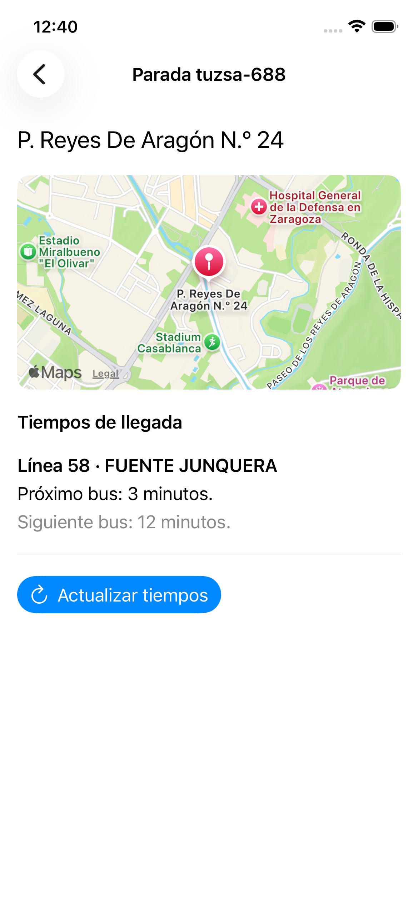

# Transportes Zaragoza

Aplicación personal para consultar paradas de tranvía, líneas de autobús, tiempos de llegada y favoritos en Zaragoza. Consume la [API municipal de transporte urbano](https://www.zaragoza.es/docs-api_sede/).

## Requisitos

- iOS 17.0 o posterior; el mínimo ya era iOS 17 antes de esta actualización, por las APIs de mapas utilizadas.
- Xcode 16.4 o posterior y Swift 6.1 o posterior. La aplicación y el package se compilan en modo Swift 6.
- Dependencia remota: Lottie 4.3.3 mediante Swift Package Manager, fijada en `Package.resolved`.
- Package local: [`TransportNetwork`](Packages/TransportNetwork), incluido en este repositorio.

Validado localmente con Xcode 27.2 y Swift 6.4.2. La configuración de CI selecciona Xcode 16.4; su ejecución remota y la compatibilidad con ese toolchain quedan pendientes.

## Ejecutar

```sh
git clone https://github.com/pablo-ziura/TransportsZaragoza.git
cd TransportsZaragoza
open TransportZaragoza.xcodeproj
```

Selecciona el scheme compartido `TransportZaragoza`, un simulador iPhone o iPad y ejecuta con **Cmd+R**. Xcode descarga Lottie; no hacen falta archivos fuera del repositorio ni claves de API. Para un dispositivo físico, selecciona tu equipo de firma en Signing & Capabilities.

Compilación sin firma para simulador:

```sh
xcodebuild build \
  -project TransportZaragoza.xcodeproj \
  -scheme TransportZaragoza \
  -configuration Debug \
  -destination 'generic/platform=iOS Simulator' \
  -disableAutomaticPackageResolution \
  -onlyUsePackageVersionsFromResolvedFile \
  CODE_SIGNING_ALLOWED=NO
```

## Tests

Pruebas del package HTTP, ejecutables en macOS sin simulador:

```sh
swift test --package-path Packages/TransportNetwork
```

Pruebas de aplicación con Swift Testing y recorrido UI con XCTest:

```sh
xcrun simctl list devices available
mkdir -p build
xcodebuild test \
  -project TransportZaragoza.xcodeproj \
  -scheme TransportZaragoza \
  -destination 'platform=iOS Simulator,id=<SIMULATOR_UDID>' \
  -parallel-testing-enabled NO \
  -resultBundlePath build/Tests.xcresult \
  CODE_SIGNING_ALLOWED=NO
```

Sustituye `<SIMULATOR_UDID>` por un identificador de la lista. Usa una ruta `.xcresult` nueva en cada ejecución. Añade `-only-testing:TransportZaragozaTests` o `-only-testing:TransportZaragozaUITests` para seleccionar una suite. El scheme incluye ambos targets; los tests del package se ejecutan por separado con el primer comando.

El transporte controlado verifica éxito, fallos HTTP y de transporte, JSON inválido, peticiones y cancelación. Los tests de aplicación cubren transiciones, reintento, vacío, respuestas fuera de orden, paginación, contratos municipales y persistencia de favoritos. XCUITest utiliza fixtures, almacenamiento aislado y un fallo recuperable; incluye un recorrido con texto de accesibilidad grande. Ninguna prueba requiere la API municipal.

[GitHub Actions](.github/workflows/ios.yml) ejecuta los tests del package, los tests de aplicación y UI y una compilación Release en cada PR y push a `main`. Conserva el `.xcresult`. No distribuye ni publica la aplicación.

## Capturas

Capturas reales del simulador iPhone 17e con iOS 26.5. Los tiempos mostrados proceden de fixtures de prueba, no de una consulta en directo.

<p>
  
</p>

## Organización y decisiones

- [`Coordinator`](TransportZaragoza/Coordinator.swift) construye las dependencias y las vistas. La composición se mantiene explícita, sin contenedor global ni framework de inyección.
- [`TransportNetwork`](Packages/TransportNetwork/Sources/TransportNetwork) contiene HTTP genérico. `NetworkClientProtocol` permite sustituir el cliente; `HTTPTransport` permite controlar respuestas y cancelación. El package no conoce Zaragoza, SwiftUI ni UserDefaults.
- Los [servicios remotos](TransportZaragoza/Data/Services) conocen los endpoints, la paginación y los modelos municipales. Se piden coordenadas WGS84 de forma explícita.
- Los [repositorios](TransportZaragoza/Data/Repositories) son actores que coordinan catálogo y favoritos. Los catálogos usan caché local; la pantalla de líneas permite actualizarlos de forma explícita. Los tiempos de autobús se solicitan al abrir el detalle o actualizar.
- Los [ViewModels de autobús](TransportZaragoza/Features/BusLines) aíslan estado de UI en `MainActor`. Separan carga de paradas y llegadas. Cada carga comprueba cancelación e identidad antes de publicar contenido o error.
- Las vistas usan tareas asociadas a su ciclo de vida. La integración UIKit de [Lottie](TransportZaragoza/LottieFiles/LottieView.swift) detiene la animación al desmontarse y respeta Reducir movimiento.

Se mantiene MVVM con `ObservableObject` y se extrae únicamente HTTP a un package: los modelos municipales y la persistencia permanecen en la aplicación. El cliente es un valor inmutable `Sendable` con un decodificador por petición; conserva la causa de los errores y limita el cuerpo HTTP de diagnóstico a 4 KiB, sin registrarlo en logs. Los dobles de prueba usan actores por instancia para evitar estado estático compartido.

El mínimo continúa en iOS 17. La animación de Lottie está incluida en el repositorio y el arranque no impone una espera artificial.

## Validación

Resultados del 16 de noviembre de 2026 con Xcode 27.2 / Swift 6.4.2 y un simulador iPhone 17e con iOS 26.5:

| Comprobación | Resultado |
| --- | --- |
| Package HTTP | 9 pruebas correctas, con casos HTTP y JSON parametrizados |
| Aplicación, Swift Testing | 11 pruebas correctas: estados, cancelación, respuestas fuera de orden, caché offline, favoritos y contratos municipales |
| XCUITest | 3 recorridos correctos: autobús con reintento y favoritos, texto grande y navegación/favoritos de tranvía |
| Compilación Debug y Release | Correctas en modo Swift 6 con comprobación completa de concurrencia |
| API real, fuera de las suites | 1.271 paradas únicas de autobús, 50 de tranvía y detalles urbano y rural decodificados correctamente |

La compilación original fallaba por una referencia a `Animation.json` fuera del repositorio. El recurso ya está incluido. Se conservan el catálogo offline y el formato anterior de favoritos; Release excluye los fixtures de prueba.

Quedan pendientes la primera ejecución remota de CI, la validación con Xcode 16.4 / Swift 6.1, la ejecución en iOS 17 y dispositivo físico y la revisión manual completa de accesibilidad.

## Datos y limitaciones

- La API es externa y puede devolver información ausente o desactualizada. Los tiempos son estimaciones; el catálogo municipal documenta tiempos solo para postes `tuzsa`. Las paradas rurales sin `destinos` muestran ausencia de información.
- Las líneas de autobús se extraen del texto `title` municipal porque así funciona el recorrido existente. Un cambio en ese formato requerirá adaptar el servicio.
- Los favoritos se guardan en el dispositivo, sin cuenta ni sincronización. Se conservan las claves y el formato anteriores.
- Los tiempos de tranvía proceden del catálogo almacenado y pueden estar desactualizados; no se ha añadido refresco individual ni temporizador. La mejora completa de estados se centra en autobuses.
- Interfaz en español. La revisión de accesibilidad cubre controles, tamaños de texto y anuncios de llegadas; no sustituye una sesión manual completa con VoiceOver en dispositivo.
- En Debug, `--ui-testing` activa respuestas locales y `--reset-storage` limpia únicamente el dominio de pruebas. Release excluye el transporte y los archivos de fixtures.

## Licencia

[MIT](LICENSE.md). Los datos municipales están sujetos a sus [condiciones de reutilización](https://www.zaragoza.es/web/espacio-de-datos/servicio/catalogo/335).
